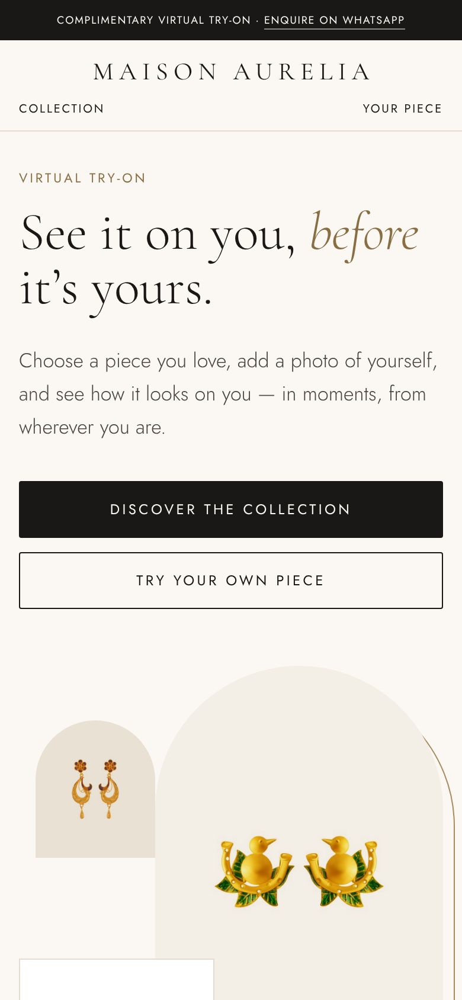
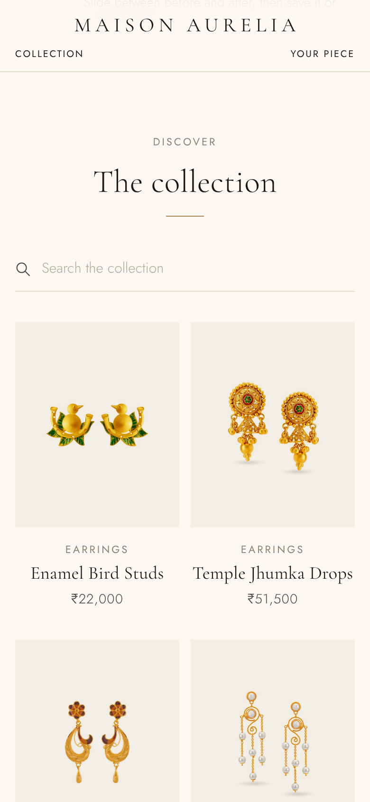
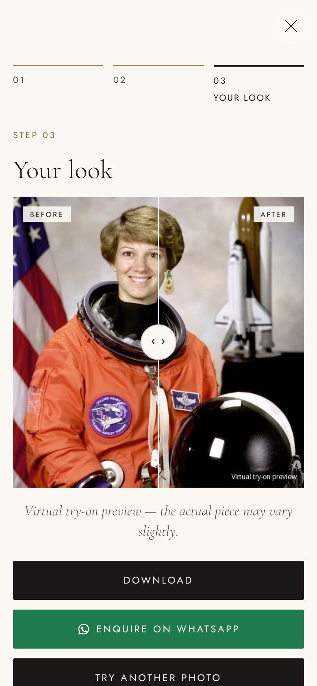
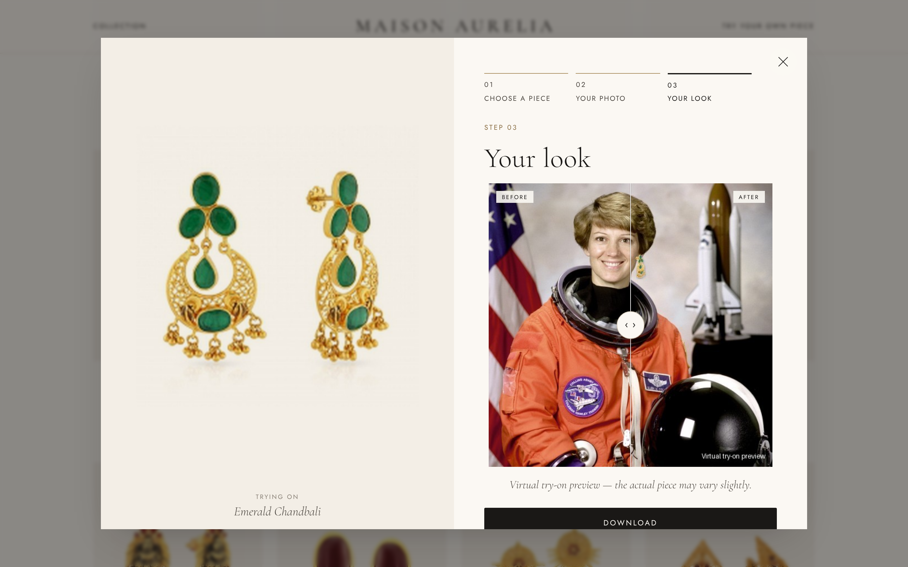
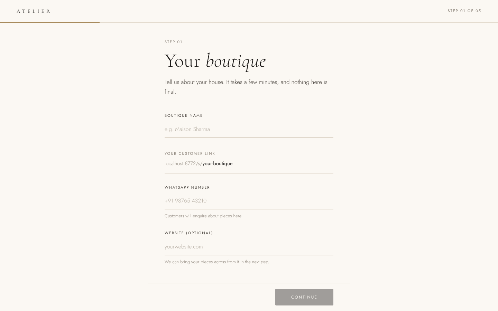
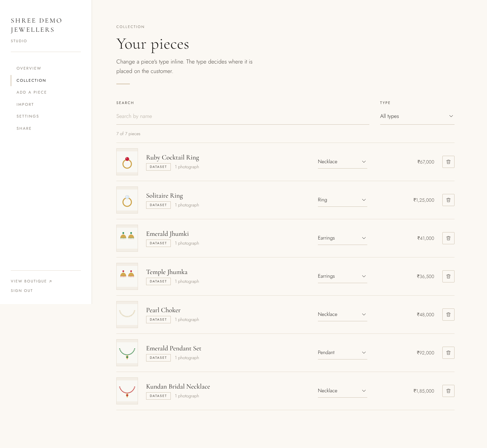

# Product Try-On

A white-label virtual try-on service for jewellers. Each jeweller (a "store") gets:

- **A customer page** at `/s/<store>`. Customers browse the collection, pick a
  piece, upload a selfie and get a photo of themselves wearing it. On the
  **"Try your own piece"** tab they can instead upload photos of any jewellery
  and try that on.
- **An admin page** at `/admin/<store>`. The jeweller adds products (details and
  3–5 photos from different angles), or **imports the catalogue from their
  existing website** (Shopify, WooCommerce, or any product page with structured
  data), and sets the WhatsApp number used for enquiries.

Everything after the customer clicks "Try it on" is automated: photo checks,
AI render, watermark, and the result with "Ask on WhatsApp".

See [PLAN.md](PLAN.md) for the product plan, competitors and roadmap.

## Run it on your computer

You need Python 3.11 or newer.

```bash
git clone https://github.com/shubhambhiwapurkar/producttryon.git
cd producttryon
git checkout claude/trusting-sagan-4rvwp1

python3 -m venv .venv
.venv/bin/pip install -r requirements.txt     # Windows: .venv\Scripts\pip install -r requirements.txt

.venv/bin/python -m scripts.demo              # creates a demo store and prints its admin token
.venv/bin/uvicorn app.main:app --reload       # starts the website on http://localhost:8000
```

Then open:

- **http://localhost:8000/s/demo**: the customer page. Pick a piece, press
  "Try it on" and upload any photo of a person; `data/demo-selfie.png` is a
  sample.
- **http://localhost:8000/admin/demo**: the jeweller's page. Paste the admin
  token that `scripts.demo` printed.

**Without an AI key vs with one:** without a key, earrings and necklaces are
placed using face detection and the exact product photo (rings and bracelets
show a basic placeholder). For AI try-ons, get a Gemini API key from
https://aistudio.google.com/apikey and start the app like this:

```bash
GEMINI_API_KEY=your-key .venv/bin/uvicorn app.main:app --reload
```

To use the other settings in `.env.example`, copy it to `.env`, fill it in, and
load it with `set -a; . ./.env; set +a` before starting the app.

### Client demo with real earrings (RingFIR)

The demo store uses real catalogue photos from the
[RingFIR earring dataset](https://github.com/skarifahmed/RingFIR) (MIT licence,
2,651 gold earrings in 46 styles). It takes one photo from each style:

```bash
git clone --depth 1 https://github.com/skarifahmed/RingFIR ../RingFIR
.venv/bin/python -m scripts.seed_ringfir ../RingFIR --store demo --create "Maison Aurelia"
.venv/bin/uvicorn app.main:app --reload       # open http://localhost:8000/s/demo
```

Try a piece on with `docs/demo/sample-customer.jpg` (a public-domain portrait),
or better, with a live selfie of your client.

- **Without an AI key** earrings use the **composite renderer**
  (`app/compositor.py`). It finds the face and hangs the jeweller's *exact*
  product photo from each ear lobe, scaled from the product size and with a
  soft shadow. It is free, instant and never alters the design. Necklaces,
  pendants, maang tikka and nose pins are placed the same way.
- **With `GEMINI_API_KEY`** the AI renderer blends the piece into the photo
  with lighting and skin contact.

**Walkthrough video (phone):** [docs/demo/try-on-walkthrough.mp4](docs/demo/try-on-walkthrough.mp4)

| Storefront | Collection | Try-on result |
|---|---|---|
|  |  |  |

| Desktop result | Onboarding wizard | Studio |
|---|---|---|
|  |  |  |

**Onboard a jeweller with the wizard:** open `http://localhost:8000/onboard`. It
walks through five steps: store details → add products (import from their
website or upload) → check categories → test a try-on → go live with a link,
QR code and a ready-to-share message. Signup needs an invite code from
`INVITE_CODES` (or the platform key) unless `OPEN_SIGNUP=true`.

Or create a store from the command line (this prints the admin token):

```bash
.venv/bin/python -m scripts.create_store demo "Demo Jewellers" --whatsapp "+91 98765 43210"
```

Then open `http://localhost:8000/admin/demo`, paste the token, and add or import
products. Customers use `http://localhost:8000/s/demo`.

## Go live (Render)

The repo includes a `Dockerfile` and a Render Blueprint (`render.yaml`), so it
runs anywhere Docker runs. Render is the simplest option: it connects to GitHub,
gives you HTTPS, and redeploys on every push.

1. **Put the code on `main`:** merge the `claude/trusting-sagan-4rvwp1` branch,
   or pick that branch when Render asks.
2. **Create the service:** sign in at https://render.com with GitHub. Choose
   **New → Blueprint** and select this repository. Render reads `render.yaml`
   and sets up a Docker web service in Singapore (closest to India) with a 5 GB
   disk for the database and photos.
3. **Fill in the variables Render asks for:**
   - `INVITE_CODES`: comma-separated codes you give jewellers for `/onboard`,
     e.g. `AURELIA2026,SHARMA-JEWELS`
   - `GEMINI_API_KEY` (optional): turns on AI renders. Without it, earrings and
     necklaces use the exact-photo compositor.

   `PLATFORM_ADMIN_KEY` is generated for you.
4. **Apply.** The first build takes about 5 minutes. Your site is then live at
   `https://<service-name>.onrender.com`:
   - `/s/demo`: the Maison Aurelia demo boutique
   - `/admin/demo`: its studio. The admin token is printed in the service's
     **Logs** at startup.
   - `/onboard`: sign up a real jeweller with an invite code
5. **Use your own domain:** in the service, go to **Settings → Custom Domains**
   and add e.g. `tryon.yourbrand.com`. Then create the CNAME record Render shows
   at your domain registrar. HTTPS is automatic.

**Cost:** the Starter instance (about $7/month) plus disk storage. Gemini
renders are billed per image only if you add a key. Check current prices at
https://render.com/pricing.

**Before onboarding paying clients:**
- Remove `SEED_DEMO`, or keep the demo store for sales calls.
- Publish a privacy policy covering customer photos (DPDP Act).
- Make sure disk backups are on.
- Add rate limiting before enabling the AI renderer.

The app runs as one instance, because try-ons run in-process and the database
is SQLite. To scale out, move to Postgres (`DATABASE_URL`), S3/R2 storage and a
job queue (see PLAN.md).

Other hosts work the same way with the `Dockerfile`:
- **Railway:** New Project → Deploy from GitHub, then add a volume at `/data`.
- **Fly.io:** `fly launch`, then add a volume at `/data`. Its Mumbai region
  (`bom`) is the closest to customers in India.

## Getting a catalogue

1. **The jeweller's own website (best):** use *Import from your website* in the
   admin page, or call `POST /api/stores/<slug>/import {"url": ..., "limit": 50}`.
   The importer tries:
   - Shopify (`/products.json`, including `/collections/<x>`)
   - the WooCommerce Store API (`/wp-json/wc/store/v1/products`)
   - the page's schema.org `Product` JSON-LD, then Open Graph tags

   It downloads up to 5 photos per product and guesses the category from the
   product's name, type and tags. It also knows Indian terms such as jhumka,
   kada, haar, payal, nath and maang tikka. Only import from sites the client
   owns or has permission to use.
2. **The admin upload form**, for products not online yet.
3. **Real stock photos for demos:** `python -m scripts.fetch_demo_photos photos/`
   downloads jewellery and model photos whose licences allow commercial use.
   It uses Pexels when `PEXELS_API_KEY` is set (free key at pexels.com/api) and
   Openverse otherwise (no key needed, Creative Commons photos, credits saved).
   Then load them with `python -m scripts.seed_from_folder photos --store demo --create "Demo Jewellers"`.
   Don't use Google Images results: they are copyrighted.
4. **An open dataset for demos**, while there is no client. Download one, for example:
   - [sidd707/jewelry-design-dataset](https://huggingface.co/datasets/sidd707/jewelry-design-dataset): about 6.1k images (necklace, earring, bracelet, ring), MIT
   - [bzcasper/ai-tool-pool-jewelry-vision](https://huggingface.co/datasets/bzcasper/ai-tool-pool-jewelry-vision): about 5.1k images in 5 categories, CC BY 4.0
   - [Tanishq Jewellery Dataset (Kaggle)](https://www.kaggle.com/datasets/sapnilpatel/tanishq-jewellery-dataset): rings and necklaces, MIT

   Check each licence on its page before using it. Then load the images:

   ```bash
   .venv/bin/python -m scripts.seed_from_folder ~/datasets/jewellery --store demo --limit 200 --create "Demo Jewellers"
   ```

   The script accepts `<category>/<images>`, `<category>/<product>/<angle images>`,
   or a flat folder with an optional `metadata.csv`.

## How the render works

`app/renderers.py` sends the customer photo and the product photos to a
multi-image editing model (Gemini image models by default; set
`GEMINI_IMAGE_MODEL`). The prompt is specific to each category: it says where the
piece is worn, tells the model to reproduce the design exactly (stones, motif,
metal, chain) and to keep the face, clothes and background unchanged. A new
renderer (for example a landmark-guided compositor for exact necklace fidelity,
or a clothing try-on API) only needs a `render(RenderRequest) -> Image` method.

## Privacy

- Customers must tick a consent box before uploading.
- Selfies, uploaded pieces and results are deleted after `RETENTION_DAYS`
  (default 7).
- Results are watermarked "AI preview".
- Admin routes need the store's token.
- URL imports refuse private and internal network addresses.

## Layout

```
app/main.py        API + page routes
app/db.py          SQLAlchemy models (Store, Product, ProductImage, TryOn)
app/renderers.py   prompts, Gemini renderer, mock renderer
app/tryon.py       background job + retention purge
app/importers.py   website catalogue import
app/netsafe.py     HTTP client that blocks internal addresses
web/               customer + admin pages (vanilla JS)
scripts/           create_store, seed_from_folder
tests/             pytest
```

Run the tests with `.venv/bin/python -m pytest -q`.

## Not built yet

- WhatsApp bot (Meta Cloud API webhook → same try-on job)
- Job queue (renders currently run as in-process background tasks)
- S3/R2 storage
- Rate limiting
- Billing
- Landmark-guided compositing for necklaces and earrings
